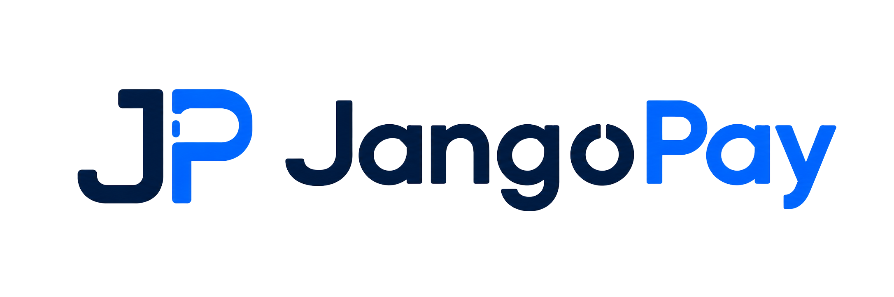
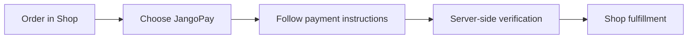

<p align="center"></p>

<p align="center"><strong>Stablecoin payments for your Azuriom community store.</strong></p>

<p align="center"><a href="README.zh-CN.md">简体中文</a> · <a href="https://market.azuriom.com/resources/256">Get it on Azuriom Market</a> · <a href="https://www.jangopay.org/">JangoPay</a></p>

# JangoPay for Azuriom Shop

Give your community another way to pay. **JangoPay brings USDT and USDC payments to Azuriom Shop**, connecting stablecoin-holding customers to your store's existing order and fulfillment workflow.

[Get the plugin →](https://market.azuriom.com/resources/256) · [Installation guide](README_EN.md) · [Download v1.0.4 ZIP](../downloads/jangopay-azuriom-1.0.4.zip)

## Built around your community

Whether your Shop sells points, memberships or digital benefits, JangoPay provides a stablecoin payment option for one-time, USD-priced orders. Keep managing your catalog and delivery through Shop, while customers follow clear cryptocurrency payment instructions.

Actual benefits and delivery depend on your Shop configuration. Available assets and networks depend on your JangoPay merchant account.

| A choice for customers | Control for merchants | Connected to Shop |
| :--- | :--- | :--- |
| Pay with supported USDT / USDC networks | Configure the asset/network pairs your store accepts | Continue the native Shop fulfillment workflow after verification |
| See the exact payment amount, network and address | Review tracked payments and reconcile outstanding records | Match payment records to the original order |

## What makes the integration useful

- **A familiar store journey** — JangoPay appears as a payment gateway in Azuriom Shop.
- **Clear payment instructions** — show the cryptocurrency amount, network and receiving address.
- **Verify before fulfillment** — authenticated merchant API checks reconcile invoice and transaction records.
- **Encrypted notifications** — RSA-OAEP-SHA256 and AES-256-GCM protect notification contents.
- **Duplicate-processing protection** — persistent tracking helps prevent repeated processing of the same payment.
- **Merchant review tools** — inspect payment status and reconcile records from your site.

## From order to payment



Customers must follow the exact asset, network, amount and address shown. The USD order price should not be treated as the cryptocurrency transfer amount.

## Get started

1. Get JangoPay from [Azuriom Market](https://market.azuriom.com/resources/256), available through the site's administration plugin area.
2. Enable Shop and JangoPay, then connect your merchant account using the [setup guide](README_EN.md).
3. Configure your USD payment gateway and allowed assets.
4. Validate notifications and the intended Shop benefit with a controlled payment before launch.

For manual installation, extract the [plugin ZIP](../downloads/jangopay-azuriom-1.0.4.zip) into `plugins/jangopay/`. The result must include `plugins/jangopay/plugin.json`; the ZIP has no extra outer folder. GitHub's entire repository ZIP is not the installation package.

## Requirements at a glance

An Azuriom site with Shop and HTTPS, a JangoPay merchant account, PHP OpenSSL support, command-line OpenSSL accessible to PHP, and `proc_open()`. Persistent server-side sessions and a cache with atomic-lock support are required.

The recorded test environment is Azuriom 1.2.13, Shop 1.2.25, PHP 8.5.11 and SQLite on one server. Follow the host framework's PHP requirements and the [detailed deployment guide](README_EN.md) for sessions, locks and secure credentials.

## Product resources

| Resource | Link |
| :--- | :--- |
| Azuriom Market listing | [View plugin](https://market.azuriom.com/resources/256) |
| Version 1.0.4 install ZIP | [Download](../downloads/jangopay-azuriom-1.0.4.zip) |
| Setup and operation | [English](README_EN.md) · [中文](README_ZH_CN.md) |
| Detailed merchant walkthrough | [中文教程](docs/MERCHANT_GUIDE_ZH_CN.md) |
| Implementation | [Source](src/) · [API contract](docs/API_CONTRACT.md) |
| Versions and validation | [Changelog](CHANGELOG.md) · [Test scope](docs/VALIDATION.md) |
| Other JangoPay integrations | [Browse plugins](../README.md) |

## Scope and release status

Version **1.0.4** covers one-time USD-priced Shop orders with account-enabled USDT / USDC networks. Subscriptions, automatic refunds, payouts and currency exchange are not included.

The supplied validation record includes one real USDT/BSC payment and fulfillment after controlled recovery and synthetic callback replay. **Final acceptance of a fresh order fulfilling automatically on its first official notification is still pending in the current repository record.** See [validation details](docs/VALIDATION.md) before production use.

<details>
<summary>Verify the v1.0.4 download</summary>

SHA-256 of `jangopay-azuriom-1.0.4.zip`:

```text
10BCDC245302F7068CF26256DA7CB88EF16EC930CE73B26C07D6942A9F2B6054
```

</details>

## Connect with JangoPay

[Website](https://www.jangopay.org/) · [Developer docs](https://doc.jangopay.org/) · [GitHub support](https://github.com/jangopay/jangopay-integrations/issues) · [contact@jangopay.org](mailto:contact@jangopay.org)

[MIT license](LICENSE) · [Third-party notices](docs/THIRD_PARTY_LICENSES.md). JangoPay branding identifies the payment service; no Azuriom endorsement is implied.
