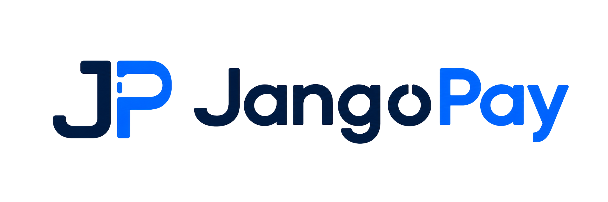
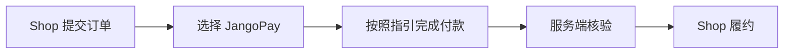

<p align="center"></p>

<p align="center"><strong>为你的 Azuriom 社区商店，增加稳定币付款方式。</strong></p>

<p align="center"><a href="README.md">English</a> · <a href="https://market.azuriom.com/resources/256">Azuriom 市场获取</a> · <a href="https://www.jangopay.org/">JangoPay 官网</a></p>

# JangoPay for Azuriom Shop

让持有稳定币的客户，也能在你的社区商店完成购买。**JangoPay 为 Azuriom Shop 增加 USDT / USDC 收款**，将付款核验连接到现有订单与履约流程。

[前往市场获取插件 →](https://market.azuriom.com/resources/256) · [安装与配置](README_ZH_CN.md) · [下载 1.0.4 安装包](../downloads/jangopay-azuriom-1.0.4.zip)

## 围绕社区商店的真实业务

无论 Shop 中销售的是积分、会员还是数字权益，都可以为一次性 USD 订单增加稳定币付款选项。商品和交付仍由 Shop 管理，客户按照清楚的数字货币付款指引完成支付。

具体权益与发放方式取决于你的 Shop 配置；可用资产与网络以 JangoPay 商户账户为准。

| 客户多一种选择 | 商户掌握收款配置 | 连接原有订单流程 |
| :--- | :--- | :--- |
| 使用支持网络上的 USDT / USDC 付款 | 配置允许接受的币种与网络组合 | 核验后进入 Shop 原生履约流程 |
| 查看准确的付款数量、网络和收款地址 | 查看付款状态，核对未完成记录 | 将收款记录与原始订单对应 |

## 为 Azuriom Shop 打造

- **融入商店结账**：在 Azuriom Shop 中添加 JangoPay 支付方式。
- **清楚的付款指引**：展示数字货币应付数量、网络及收款地址。
- **核验后履约**：通过商户 API 核对收款单和交易记录。
- **加密付款通知**：使用 RSA-OAEP-SHA256 与 AES-256-GCM 保护通知内容。
- **重复处理保护**：持久化付款记录，控制重复通知处理。
- **商户核查工具**：在网站后台查看支付状态并进行对账。

## 从下单到付款



客户需严格按照页面显示的币种、网络、数量和地址付款；USD 订单价格不等于数字货币转账数量。

## 开始使用

1. 在 [Azuriom 市场](https://market.azuriom.com/resources/256)获取 JangoPay，也可从网站后台的插件区域安装市场扩展。
2. 启用 Shop 和 JangoPay，按照[配置指南](README_ZH_CN.md)连接商户账户。
3. 配置 USD 支付方式和允许资产。
4. 用受控订单验证付款通知、订单核验及预期权益发放，再上线收款。

手动安装时，将[安装包](../downloads/jangopay-azuriom-1.0.4.zip)内容解压到 `plugins/jangopay/`，确认存在 `plugins/jangopay/plugin.json`。包内没有多余外层目录；整个 GitHub 仓库 ZIP 不用于直接安装。

## 运行条件

需要已安装 Shop 的 Azuriom 网站、HTTPS、JangoPay 商户账户、PHP OpenSSL、PHP 可调用的命令行 OpenSSL，以及 `proc_open()`。Session 需在服务端持久化，缓存需支持原子锁。

记录中的测试环境为 Azuriom 1.2.13、Shop 1.2.25、PHP 8.5.11、SQLite 单机。部署须满足宿主框架的 PHP 要求；会话、锁、密钥和回调配置见[详细商户教程](docs/MERCHANT_GUIDE_ZH_CN.md)。

## 下载与资料

| 你需要什么 | 获取 |
| :--- | :--- |
| Azuriom 市场产品页 | [查看插件](https://market.azuriom.com/resources/256) |
| 1.0.4 安装包 | [下载 ZIP](../downloads/jangopay-azuriom-1.0.4.zip) |
| 安装与日常操作 | [中文](README_ZH_CN.md) · [English](README_EN.md) |
| 分步商户教程 | [完整中文教程](docs/MERCHANT_GUIDE_ZH_CN.md) |
| 技术实现 | [源码](src/) · [接口契约](docs/API_CONTRACT.md) |
| 版本与验证 | [更新记录](CHANGELOG.md) · [测试范围](docs/VALIDATION.md) |
| 其他 JangoPay 插件 | [查看插件目录](../README.zh-CN.md) |

## 适用范围与发布状态

当前版本 **1.0.4** 用于账户已开通 USDT / USDC 网络上的一次性 USD 订单。不包含订阅、自动退款、出款或币种兑换。

现有验收记录包括一笔真实 USDT/BSC 支付，以及受控恢复和合成通知重放后的交付。**仓库当前仍记录“全新订单收到首次官方通知后自动履约”待最终验收**；生产使用前请阅读[测试与验收说明](docs/VALIDATION.md)。

<details>
<summary>校验 1.0.4 安装包</summary>

`jangopay-azuriom-1.0.4.zip` 的 SHA-256：

```text
10BCDC245302F7068CF26256DA7CB88EF16EC930CE73B26C07D6942A9F2B6054
```

</details>

## 联系 JangoPay

[官网](https://www.jangopay.org/) · [开发文档](https://doc.jangopay.org/) · [GitHub 问题反馈](https://github.com/jangopay/jangopay-integrations/issues) · [contact@jangopay.org](mailto:contact@jangopay.org)

[MIT 许可证](LICENSE) · [第三方声明](docs/THIRD_PARTY_LICENSES.md)。JangoPay 品牌用于标明支付服务，不代表 Azuriom 官方背书。
