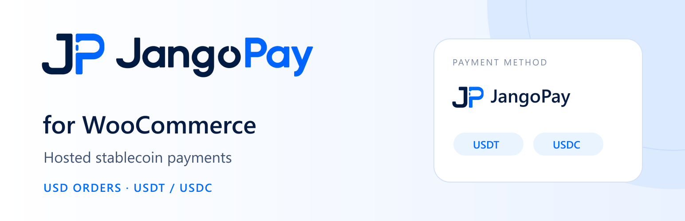
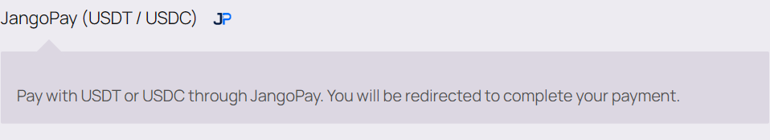
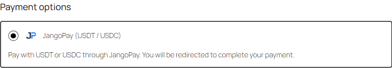
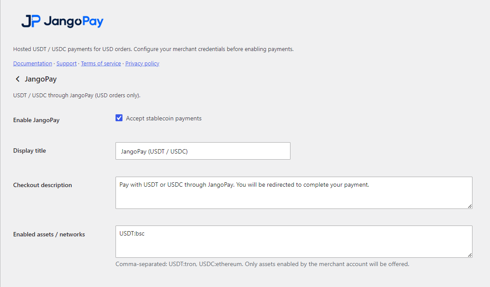

<a href="README.zh-CN.md">简体中文</a> · <a href="https://wordpress.org/plugins/jangopay-for-woocommerce/">Get it on WordPress.org</a> · <a href="https://www.jangopay.org/">JangoPay</a>

# Bring stablecoin payments to your WooCommerce store

**JangoPay for WooCommerce** adds USDT and USDC payments to your store through JangoPay hosted checkout. Give stablecoin-holding customers another way to buy, while keeping products, orders and everyday operations in WooCommerce.

[Get the WordPress plugin →](https://wordpress.org/plugins/jangopay-for-woocommerce/) · [Installation guide](docs/SETUP.md) · [Download version 1.0.2](../downloads/jangopay-woocommerce-1.0.2.zip)

## Another way to pay. A familiar way to run your store.

| For customers | For merchants |
| :--- | :--- |
| Choose JangoPay at checkout and pay with USDT or USDC | Add a payment method to an existing WooCommerce store |
| Select an available asset and network on hosted checkout | Manage checkout text and allowed assets in payment settings |
| Return to the store after payment | Synchronize payment results through verification, notifications and reconciliation |

Designed for one-time products and services priced in USD. Available assets, networks and service coverage depend on the JangoPay merchant account.

## Built for WooCommerce

- **Classic checkout and Checkout Blocks** — support both checkout experiences.
- **CPT and HPOS** — work with traditional and High-Performance Order Storage.
- **Hosted checkout** — customers select their payment asset and complete payment with JangoPay.
- **Verified order updates** — encrypted notifications and authenticated API checks reconcile orders, transactions and amounts.
- **Reconciliation and recovery** — hourly scheduled reconciliation and merchant-initiated re-verification help resolve outstanding records.
- **A consistent payment identity** — JangoPay icons and configurable checkout wording.

## The customer journey

1. Place an order in your WooCommerce store and choose **JangoPay**.
2. Continue to JangoPay hosted checkout, select an available asset/network and pay.
3. The store verifies payment server-side, updates the order and continues its existing fulfillment workflow.

## See it in your store

### Classic checkout

### Checkout Blocks

Merchant payment settings

## Get started

Install → configure server credentials and callbacks → enable JangoPay → validate the complete payment flow.

Requires HTTPS, WordPress 6.4+, WooCommerce 8.3+, PHP 8.1+ with PHP OpenSSL, and an eligible JangoPay merchant account. The install package runs without Composer or the OpenSSL command-line program on the merchant host.

[Read the installation guide →](docs/SETUP.md)

## Downloads and resources

| Resource | Link |
| :--- | :--- |
| Official WordPress plugin directory | [WordPress.org](https://wordpress.org/plugins/jangopay-for-woocommerce/) |
| Version 1.0.2 WordPress-installable ZIP | [Download](../downloads/jangopay-woocommerce-1.0.2.zip) |
| Complete source, runtime dependencies, build files and all test evidence | [Full source bundle](../downloads/jangopay-woocommerce-1.0.2-source-tests.zip) |
| Browse core implementation and tests | [Source](source/) |
| Merchant setup and operation | [English](docs/SETUP.md) · [中文](docs/SETUP.zh-CN.md) |
| Architecture, API contract, build and validation | [English](docs/TECHNICAL.md) · [中文](docs/TECHNICAL.zh-CN.md) |
| Package verification | [SHA256SUMS.txt](SHA256SUMS.txt) |

Use the install ZIP in WordPress. The entire GitHub repository ZIP and full development bundle are not WordPress-installable packages.

## Version and scope

This publication corresponds to **1.0.2**, rebuilding the privately scoped phpseclib 4.0.2 runtime. See the [changelog](source/jangopay-for-woocommerce/CHANGELOG.md).

Supports one-time USD orders. Subscriptions, other fiat order currencies, automatic gateway refunds, payouts and exchange services are outside this plugin's scope. A manual WooCommerce refund records bookkeeping; it does not send cryptocurrency.

## Connect with JangoPay

[Website](https://www.jangopay.org/) · [Developer docs](https://doc.jangopay.org/documentation) · [WordPress support](https://wordpress.org/support/plugin/jangopay-for-woocommerce/) · [GitHub issues](https://github.com/jangopay/jangopay-integrations/issues) · [contact@jangopay.org](mailto:contact@jangopay.org)

Licensed under [GPL-2.0-or-later](source/jangopay-for-woocommerce/LICENSE); dependencies retain their own notices. JangoPay branding identifies the service and does not imply WordPress or WooCommerce endorsement.
