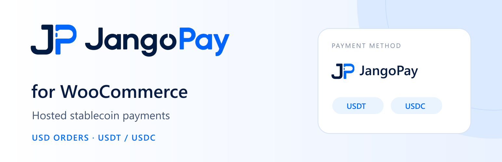
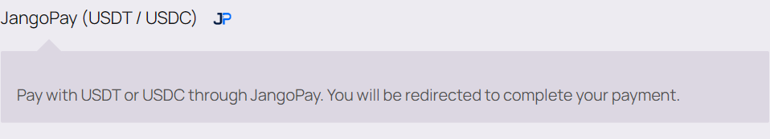
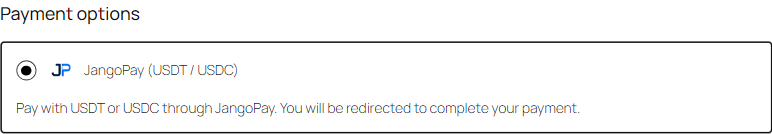
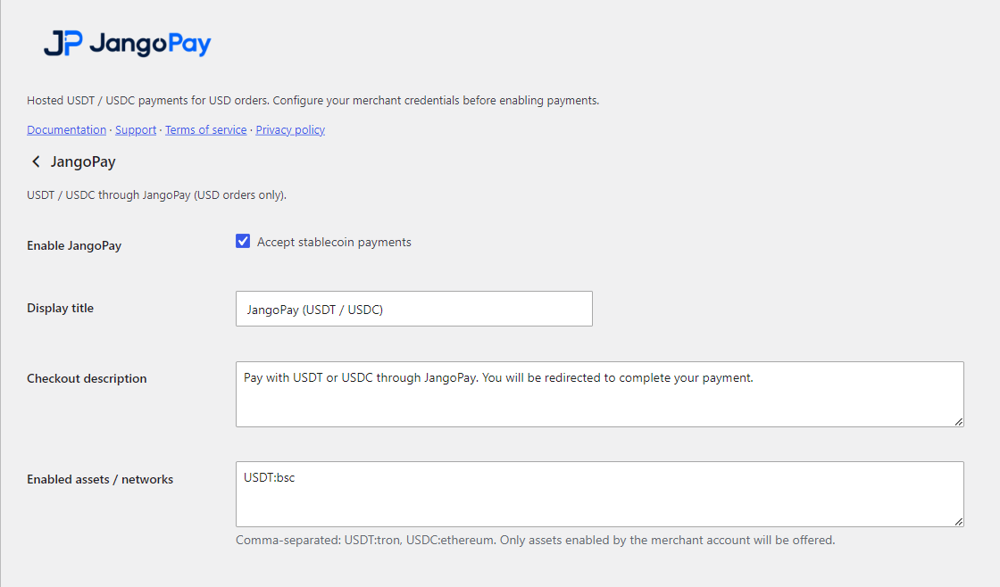

<a href="README.md">English</a> · <a href="https://wordpress.org/plugins/jangopay-for-woocommerce/">WordPress.org 下载</a> · <a href="https://www.jangopay.org/">JangoPay 官网</a>

# 为你的 WooCommerce 商店，开启稳定币收款

**JangoPay for WooCommerce** 为你的商店增加 USDT / USDC 付款选项，让持有稳定币的客户通过 JangoPay 托管收银台完成购买。商品、订单和日常运营继续留在熟悉的 WooCommerce 后台。

[从 WordPress.org 获取插件 →](https://wordpress.org/plugins/jangopay-for-woocommerce/) · [安装与配置](docs/SETUP.zh-CN.md) · [下载 1.0.2 安装包](../downloads/jangopay-woocommerce-1.0.2.zip)

## 让稳定币支付，融入现有商店

| 为客户 | 为商户 |
| :--- | :--- |
| 在结账时选择 JangoPay，用 USDT 或 USDC 付款 | 为现有 WooCommerce 商店增加一种付款方式 |
| 在托管收银台选择可用的币种与网络 | 在支付设置中管理展示文案与允许资产 |
| 完成付款后返回店铺查看订单 | 通过服务端核验、通知与对账同步付款结果 |

适合以 USD 计价的一次性商品与服务订单。实际可用币种、网络和服务范围以 JangoPay 商户账户配置为准。

## 为 WooCommerce 打造

- **经典结账与 Checkout Blocks**：支持 WooCommerce 的两种结账体验。
- **传统订单存储与 HPOS**：兼顾 CPT 与高性能订单存储模式。
- **托管收银台**：买家在 JangoPay 完成资产选择和付款，店铺保持清晰的订单流程。
- **核验后同步订单**：加密通知结合商户 API 核验订单、交易与金额，浏览器回跳不作为付款凭证。
- **持续对账与恢复**：每小时计划任务处理未完成记录，商户可按需重新核验订单。
- **品牌一致的付款入口**：使用 JangoPay 图标与支付展示文案。

## 客户如何付款

1. 在你的 WooCommerce 商店提交订单，选择 **JangoPay**。
2. 进入 JangoPay 托管收银台，选择可用资产与网络并完成付款。
3. 店铺服务端核验付款结果，更新订单，继续原有订单履约流程。

## 产品预览

### 经典结账

### Checkout Blocks

查看商户支付设置

## 几步完成接入

安装插件 → 配置服务端凭据与回调 → 开启 JangoPay → 验证完整付款流程。

需要 HTTPS、WordPress 6.4+、WooCommerce 8.3+、PHP 8.1+ 和 PHP OpenSSL 扩展，以及符合平台要求的 JangoPay 商户账户。商户服务器不需要 Composer 或命令行 OpenSSL 即可运行安装包。

[查看完整安装指南 →](docs/SETUP.zh-CN.md)

## 下载与资料

| 你需要什么 | 获取 |
| :--- | :--- |
| WordPress 官方插件目录 | [WordPress.org](https://wordpress.org/plugins/jangopay-for-woocommerce/) |
| 直接上传 WordPress 的 1.0.2 安装包 | [下载 ZIP](../downloads/jangopay-woocommerce-1.0.2.zip) |
| 完整源码、运行依赖及构建文件 | [下载完整源码包](../downloads/jangopay-woocommerce-1.0.2-source-tests.zip) |
| 在线阅读核心源码与测试 | [浏览源码](source/) |
| 商户配置与操作 | [中文](docs/SETUP.zh-CN.md) · [English](docs/SETUP.md) |
| 技术架构、接口与构建说明 | [中文](docs/TECHNICAL.zh-CN.md) · [English](docs/TECHNICAL.md) |
| 包校验 | [SHA256SUMS.txt](SHA256SUMS.txt) |

安装请使用安装包；GitHub 的整个仓库 ZIP 和完整源码测试包都不是 WordPress 后台安装包。

## 版本与支持范围

当前 GitHub 发布资料对应 **1.0.2**。本版重建了私有命名空间的 phpseclib 4.0.2 运行依赖；完整变更见[更新记录](source/jangopay-for-woocommerce/CHANGELOG.md)。

当前支持一次性 USD 订单，不包含订阅、其他法币计价、网关自动退款、出款或兑换功能。WooCommerce 中手动记录退款不会自动退回数字货币。

## 联系 JangoPay

[官网](https://www.jangopay.org/) · [开发文档](https://doc.jangopay.org/documentation) · [WordPress 支持论坛](https://wordpress.org/support/plugin/jangopay-for-woocommerce/) · [GitHub 问题反馈](https://github.com/jangopay/jangopay-integrations/issues) · [contact@jangopay.org](mailto:contact@jangopay.org)

插件采用 [GPL-2.0-or-later](source/jangopay-for-woocommerce/LICENSE)，依赖保留各自许可声明。JangoPay 品牌标识用于标明服务，不代表 WordPress 或 WooCommerce 的背书。
